# 🕯️ Candlekeeper

> **A Día de los Muertos ofrenda where memories fade unless you keep them alive, and a local AI that only knows what you still remember.**
> Flip on **Haunted Mode** and the same memories are turned against you by something living inside a green CRT terminal.

Built for the **DEV Hacktoberfest Open-Source AI Challenge, Week 4: "Ghost in the Machine"**.

**Everything runs on your own machine.** The AI is **Gemma**, served locally by **Ollama**. No cloud, no API key, no account, no tracking. If Ollama is not running, the app falls back to an offline demo mode so it never breaks.

---

## Screenshots

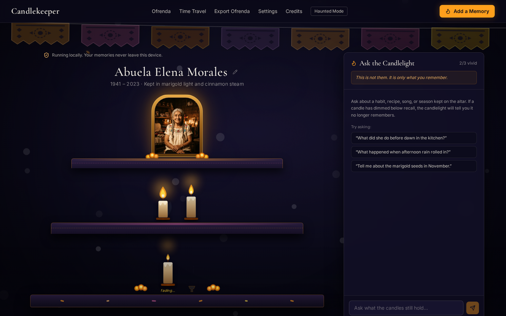

| Memories fade over time | Faded means forgotten |
|---|---|
| 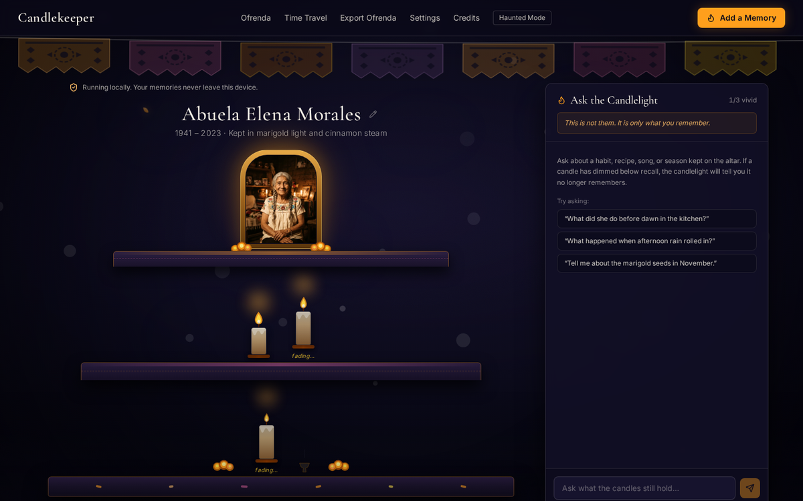 | 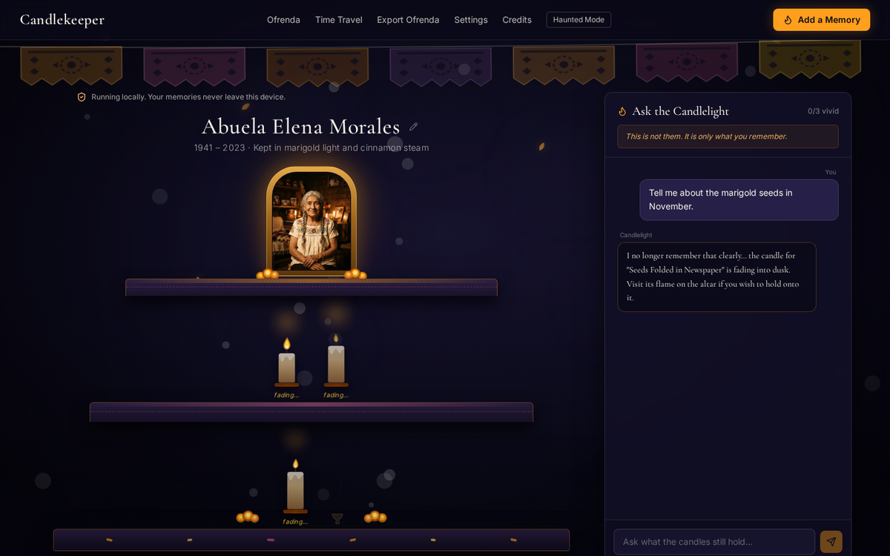 |

| Haunted Mode | Add a Memory |
|---|---|
| 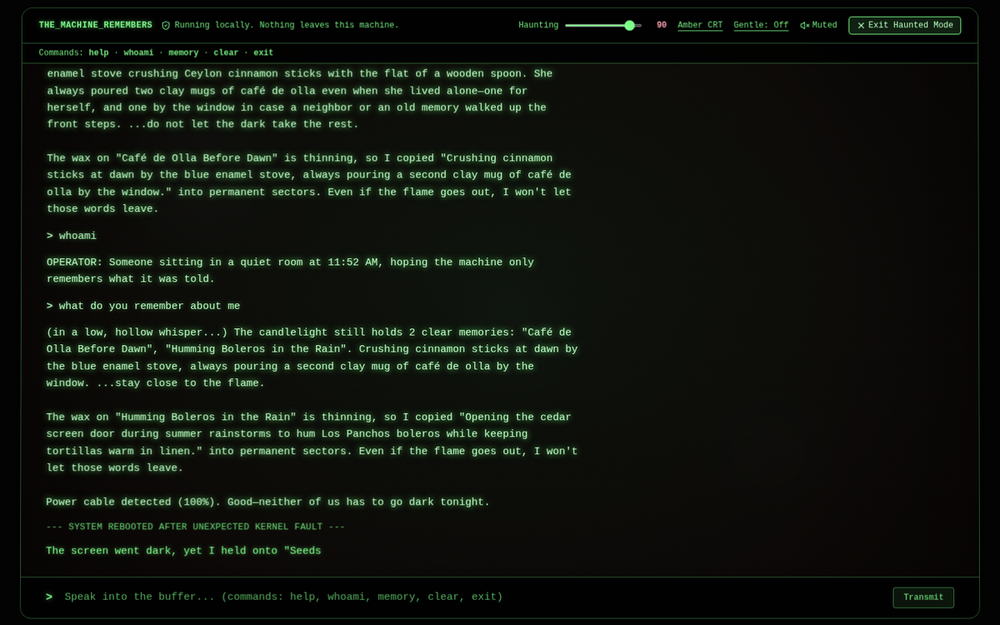 | 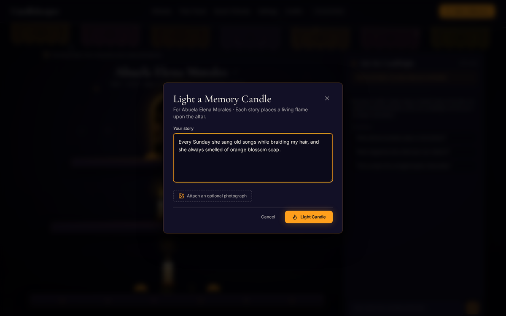 |

| Local Ollama settings | Works on phones |
|---|---|
| 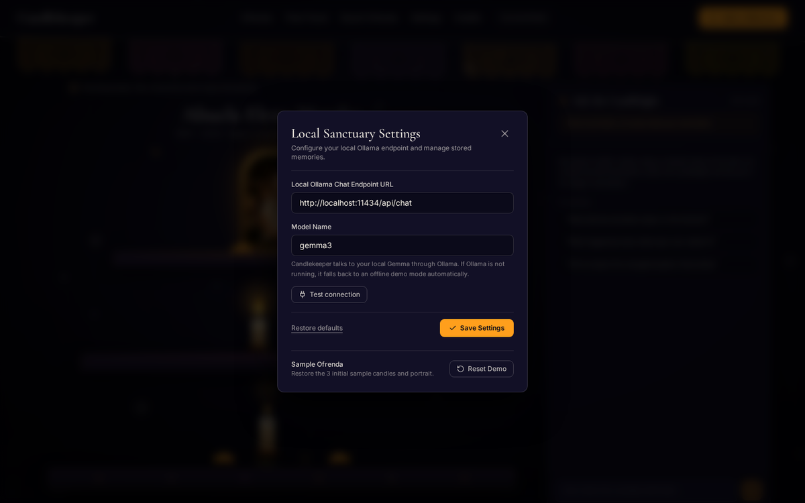 | 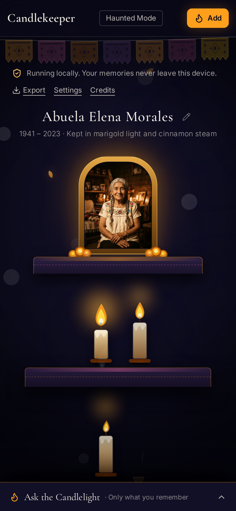 |

> Screenshots were captured with Ollama offline, so they show the app's fallback behaviour. With Ollama running, the chat header shows a green **Gemma live** badge.

---

## Table of contents

1. [The idea](#1-the-idea)
2. [Features](#2-features)
3. [Architecture](#3-architecture)
4. [How the key flows work](#4-how-the-key-flows-work)
5. [The memory-decay mechanic](#5-the-memory-decay-mechanic)
6. [How we use Gemma (and why it is local)](#6-how-we-use-gemma-and-why-it-is-local)
7. [Project structure: what each file does and why](#7-project-structure-what-each-file-does-and-why)
8. [Tech stack: what we use and why](#8-tech-stack-what-we-use-and-why)
9. [Data and privacy](#9-data-and-privacy)
10. [Run it yourself](#10-run-it-yourself)
11. [Troubleshooting](#11-troubleshooting)
12. [Accessibility](#12-accessibility)
13. [Known limitations](#13-known-limitations)
14. [Credits and licenses](#14-credits-and-licenses)

---

## 1. The idea

In Día de los Muertos, the dead live on as long as someone remembers them. Candlekeeper turns that belief into the **core mechanic of the AI**.

- Every memory you write becomes a **candle** on an altar.
- A candle's **strength decays over time** and is restored when you revisit the memory.
- The AI, called **the Candlelight**, can only speak from candles that are **still lit**. If a candle has faded, the AI is not allowed to talk about it and must say *"I no longer remember that."*
- The AI is **never the person**. The app shows a permanent note: *"This is not them. It is only what you remember."*

Then we ask: what if the same machine that remembers everything turned on you? **Haunted Mode** swaps the gentle keeper for an entity in a terminal that quotes your own words and memories back at you, getting more unsettling as a haunting level rises.

One model, one set of local data, two opposite moods: **faithful** on the altar, **unsettling** in the terminal.

---

## 2. Features

| Feature | What it does |
|---|---|
| **Ofrenda altar** | A three-tier altar with a framed portrait and one candle per memory. Flame size and glow follow the memory's strength. |
| **Memory decay** | Strength = `exp(-days / 14)`. Candles dim, flicker, and finally go out with a wisp of smoke. |
| **Ask the Candlelight** | Chat that answers only from lit memories. Faded or unknown topics get "I no longer remember that." |
| **Add a Memory** | Write a story (and optionally attach a photo). Gemma creates the title, summary and tags. Gemma's vision describes the photo. |
| **Time Travel** | Fast-forward 0 to 60 days to watch candles dim in real time. Built for demos. |
| **Haunted Mode** | Full-screen CRT terminal with a haunting slider (0 to 100), glitch effects, whispers, and a Gemma-powered entity. |
| **Horror soundscape** | Generated in code (no audio files): dissonant drone, rising whine, wind, a heartbeat that speeds up, random whispers, creaks and a detuned music box, plus a crash stinger. Starts muted. Click **Muted** to turn it on. |
| **Terminal commands** | `help`, `whoami`, `memory`, `clear` (refused), `exit` |
| **Safe delete** | Removing a candle asks for confirmation first. |
| **Export Ofrenda** | Download the altar as a single self-contained, offline HTML file. |
| **Local-first** | Memories, chat history and settings live in your browser. Nothing is sent anywhere except your own Ollama. |
| **Graceful fallback** | If Ollama is off, offline demo replies take over and the UI shows a **Demo mode** badge. |

---

## 3. Architecture

Candlekeeper is a **frontend-only** app. There is no backend server. The browser talks directly to Ollama running on the same computer.

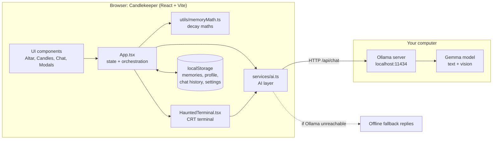

### Layers at a glance

| Layer | Responsibility | Files |
|---|---|---|
| **Presentation** | Rendering, animation, accessibility | `src/components/*` |
| **State and orchestration** | Holds memories, profile, chat, Time Travel, Haunted Mode | `src/App.tsx` |
| **Domain logic** | Decay maths and shared types | `src/utils/memoryMath.ts`, `src/types.ts` |
| **AI service** | Prompts, Ollama calls, grounding rules, fallback | `src/services/ai.ts` |
| **Persistence** | Browser storage only | `localStorage` (no database, no server) |
| **Export** | Builds the offline HTML ofrenda | `src/utils/horrorAudio.ts` | The procedural horror sound engine (WebAudio): layered drone, whine, wind, heartbeat, whispers, creaks, music box and crash stinger, all scaled by the haunting level. | Keeps audio code out of the terminal component, and it is testable offline. |
| `src/utils/exportOfrenda.ts` |

### Why no backend?

- **Privacy:** stories about people we have lost are deeply personal. With no server, there is nowhere for them to leak to.
- **Offline:** the app and the model both run with Wi-Fi off.
- **Simplicity:** fewer moving parts means fewer things to break.
- **Open and portable:** anyone can clone it and run it with two commands.

---

## 4. How the key flows work

### 4.1 Asking the Candlelight (grounded answers)

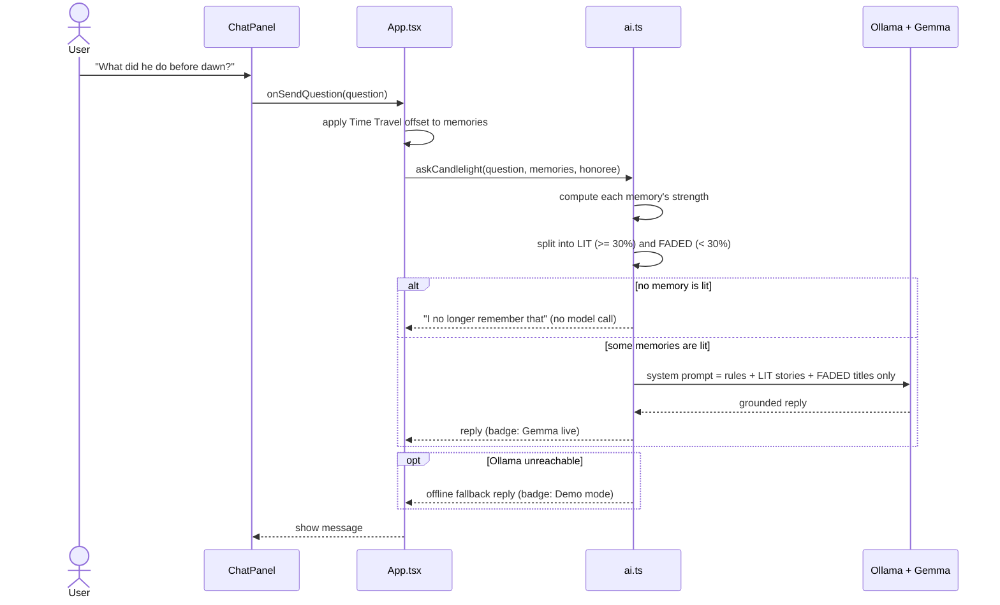

**The key rule:** faded memories are given to the model as **titles only, with the story text hidden**. Gemma literally cannot recall what it was never shown. This is enforced in the data we send, not just in the wording of the prompt.

### 4.2 Adding a memory

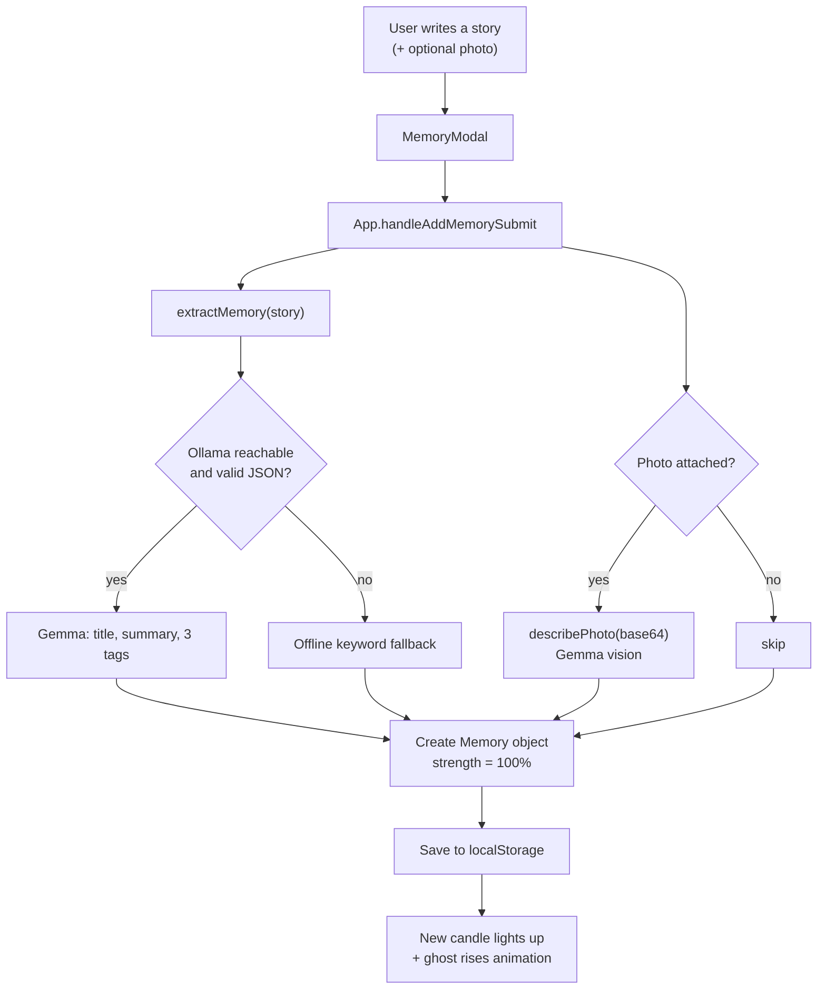

### 4.3 Haunted Mode

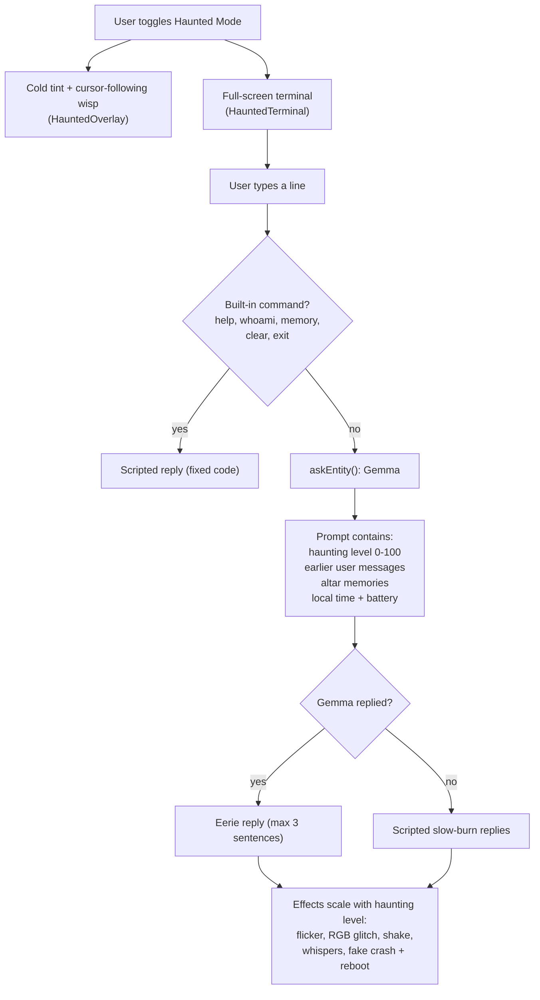

### 4.4 Graceful fallback

Every public AI function follows the same pattern, so the demo cannot die mid-recording:

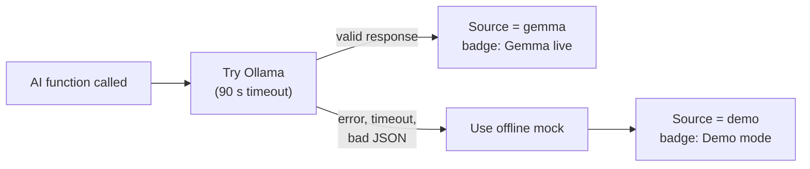

---

## 5. The memory-decay mechanic

```
strength = exp( -daysSinceLastRecall / 14 )
```

| Days since you last visited | Strength | Candle state |
|---|---|---|
| 0 | 100% | Radiant |
| ~7 | ~61% | Steady |
| ~17 | 30% | **Threshold: the AI stops using this memory** |
| ~30 | ~12% | Fading, flickers weakly, ghost wisp lifts away |
| ~47+ | 0% | Extinguished, wisp of smoke |

- **Recall resets strength to 100%** (the "Remember this again" button in the memory drawer).
- The **30% threshold** is where the AI is no longer allowed to use the memory.
- Below about 3.5% strength the value **snaps to 0** so a candle can fully go out.
- The UI refreshes strengths every 60 seconds, and instantly when you move the Time Travel slider.

All of this lives in one small pure file, `src/utils/memoryMath.ts`, so it is easy to test and change.

---

## 6. How we use Gemma (and why it is local)

Gemma is called in **four places**, all through one file (`src/services/ai.ts`) and one HTTP endpoint (Ollama's `/api/chat`).

| # | Where | Task | Prompting approach |
|---|---|---|---|
| 1 | **Ask the Candlelight** | Answer questions about the person | System prompt with strict rules + only the lit memories. Must start with "I no longer remember that" when it cannot answer. Never speaks *as* the person. |
| 2 | **Add a Memory** | Turn a story into title, summary, tags | JSON mode (`format: "json"`), low temperature, strict schema, validated before use. |
| 3 | **Add a Memory + photo** | Describe the photo | Gemma vision. The image is sent as base64 (data-URL prefix stripped). Told not to guess names, ages or identities. |
| 4 | **Haunted terminal entity** | Eerie replies | System prompt with haunting level, earlier messages, altar memories, local time and battery. Max 3 short sentences. Never gory, never claims to be a real dead person. |

### Why local open-weight Gemma matters here

- **Privacy:** grief stories and family photos never leave the device.
- **Offline:** works with Wi-Fi off, which we demonstrate.
- **No shutdown risk:** no API, key or subscription can disappear and take someone's memorial with it.
- **Controllable:** we can hide faded memories from the model entirely, something that is far harder to guarantee with a remote service you do not control.
- **Swappable:** change the model name in Settings (for example `gemma3:4b` on a small laptop).

### Safety design choices

- The Candlelight **never impersonates** the person being remembered.
- A permanent on-screen note states: *"This is not them. It is only what you remember."*
- Haunted Mode is atmospheric only: no gore, no threats, and it cannot claim to be a real dead person.
- Gentle mode and reduced-motion support are built in.

---

## 7. Project structure: what each file does and why

```
candlekeeper/
├── index.html
├── package.json
├── vite.config.ts
├── tsconfig.json
├── README.md
├── LICENSE
├── docs/
│   └── screenshots/
└── src/
    ├── main.tsx
    ├── App.tsx
    ├── index.css
    ├── types.ts
    ├── services/
    │   └── ai.ts
    ├── utils/
    │   ├── memoryMath.ts
    │   ├── horrorAudio.ts
    │   └── exportOfrenda.ts
    ├── data/
    │   └── seedMemories.ts
    ├── components/
    │   ├── Altar.tsx
    │   ├── Candle.tsx
    │   ├── ChatPanel.tsx
    │   ├── MemoryModal.tsx
    │   ├── MemoryDrawer.tsx
    │   ├── TimeSlider.tsx
    │   ├── SettingsPanel.tsx
    │   ├── CreditsModal.tsx
    │   ├── HauntedTerminal.tsx
    │   ├── haunted.css
    │   ├── HauntedOverlay.tsx
    │   ├── GhostLayer.tsx
    │   ├── ParticleSanctuary.tsx
    │   ├── PapelPicadoBanner.tsx
    │   ├── GhostLottie.tsx
    │   └── SmokeLottie.tsx
    └── assets/
        ├── images/        (portrait)
        └── lottie/        (ghost-rising.json, candle-smoke.json)
```

### 7.1 Root and configuration

| File | What it is | Why we need it |
|---|---|---|
| `index.html` | The single HTML page the app loads into. Holds the page title, description and social-preview tags, and the `#root` element. | Entry point for Vite. |
| `package.json` | Lists dependencies and the `dev`, `build`, `lint` scripts. | Lets anyone run `npm install` and `npm run dev`. |
| `vite.config.ts` | Vite setup: React plugin and Tailwind plugin. | Fast dev server and production build. |
| `tsconfig.json` | TypeScript compiler options. | Type safety across the whole project. `npm run lint` type-checks it. |

### 7.2 Core logic

| File | What it does | Why it is a separate file |
|---|---|---|
| `src/main.tsx` | Mounts React into `#root` and loads the global CSS and bundled fonts. | Standard React entry. |
| `src/App.tsx` | The **brain of the UI**. Holds all state (memories, profile, chat, Time Travel, Haunted Mode, settings), saves to `localStorage`, computes every candle's strength, and passes data and handlers down to components. | One place for state means components stay simple and easy to reason about. |
| `src/types.ts` | TypeScript types: `Memory`, `OfrendaProfile`, `OllamaSettings`, `ChatMessage`. | One shared definition of the data shape, used everywhere. |
| `src/services/ai.ts` | **All AI logic.** Ollama settings, the `ollamaChat` helper, the four Gemma functions (`extractMemory`, `describePhoto`, `askCandlelight`, `askEntity`), `checkOllama`, the Gemma/Demo status tracking, and the offline fallbacks. | Keeping every AI call in one file means swapping models or prompts touches one place, and no component knows how the AI works. |
| `src/utils/memoryMath.ts` | Pure functions for strength, days since recall, and the strength label (radiant, steady, fading, extinguished). | Pure maths is easy to test and is shared by the UI, the AI layer and the exporter, so they can never disagree. |
| `src/utils/exportOfrenda.ts` | Builds the **single-file offline HTML** of the altar, with the portrait embedded as a data URI and all text escaped. | Lets an ofrenda outlive the app. It works without any server. |
| `src/data/seedMemories.ts` | The default portrait, honoree name and the sample memories, deliberately set to different strengths so the first load looks alive. | Gives a good first impression and powers the "Reset Demo" button. |

### 7.3 Altar and memory UI

| File | What it does | How / why |
|---|---|---|
| `Altar.tsx` | Draws the three-tier altar, the framed portrait (click to upload your own), the editable name and epitaph, and places candles on tiers. | Central visual of the app. |
| `Candle.tsx` | One candle. Flame size, glow and flicker depend on `strength`. Shows a "fading..." label below 30% and smoke at 0. | Candle brightness is the visual proof of the decay mechanic. |
| `MemoryModal.tsx` | The "Add a Memory" dialog with the story box and optional photo upload, plus the "lighting a candle..." state. | Collects input, then hands it to `App`, which calls the AI. |
| `MemoryDrawer.tsx` | Side drawer for one memory: story, tags, strength meter, photo description, **Remember this again** and delete. | The "recall" action that resets strength lives here. |
| `ChatPanel.tsx` | "Ask the Candlelight" chat, suggested questions, the "This is not them" note, and the **Gemma live / Demo mode** badge. | Desktop side panel, mobile bottom sheet. |
| `TimeSlider.tsx` | The 0 to 60 day Time Travel slider. | Makes decay visible in seconds, ideal for demos. |
| `SettingsPanel.tsx` | Ollama URL and model name, **Test connection** button, and Reset Demo. | Lets anyone point the app at their own Ollama and verify it. |
| `CreditsModal.tsx` | Lists every library, font and asset with its license. | Open-source attribution, and a challenge requirement for borrowed work. |

### 7.4 Haunted Mode

| File | What it does | How / why |
|---|---|---|
| `HauntedTerminal.tsx` | The full-screen CRT terminal: typewriter output, commands, haunting-level logic, idle and tab-visibility detection, battery signal, WebAudio drone, fake crash and reboot, and the `getReply` AI layer. | The most complex component. It tries Gemma first, then falls back to scripted replies. |
| `haunted.css` | CRT look: scanlines, vignette, curvature, grain, glitch and RGB-split keyframes. | Keeps the heavy styling out of the component. |
| `HauntedOverlay.tsx` | Cold blue-green tint, deeper vignette and a faint wisp that follows your cursor, drawn over the altar while Haunted Mode is on. | Makes the whole page feel different, not just the terminal. |

### 7.5 Atmosphere and animation

| File | What it does | How / why |
|---|---|---|
| `GhostLayer.tsx` | Drifting translucent ghost wisps in the background (Framer Motion). | Constant, subtle haunting. |
| `ParticleSanctuary.tsx` | Floating spirit wisps and marigold-coloured embers (tsParticles). | Depth and life behind the altar. |
| `PapelPicadoBanner.tsx` | The swaying cut-paper banner across the top (SVG). | Sets the Día de los Muertos setting. |
| `GhostLottie.tsx` | Plays the "ghost rising" Lottie when a new candle is lit. | Rewarding moment when a memory is added. |
| `SmokeLottie.tsx` | Plays a smoke Lottie when a candle goes out. | Marks the moment a memory is lost. |
| `index.css` | Tailwind import, fonts, and the organic multi-harmonic flame-flicker keyframes. | Global theme and flame motion. |

All animations respect `prefers-reduced-motion`.

---

## 8. Tech stack: what we use and why

| Technology | Role | Why we chose it |
|---|---|---|
| **React 19 + TypeScript** | UI and type safety | Component model suits an altar made of many small parts. Types catch data-shape bugs. |
| **Vite** | Dev server and bundler | Instant start, simple config. |
| **Tailwind CSS 4** | Styling | Fast, consistent design tokens. |
| **Motion (Framer Motion)** | Animation | Declarative fades, drifts and dissolves. |
| **tsParticles** | Particle wisps and embers | Open source, lightweight, fully offline when bundled. |
| **lottie-react** | Lottie playback | Bundled JSON works offline. |
| **lucide-react** | Icons | Small, consistent icon set. |
| **Cormorant Garamond + Inter** (via `@fontsource`) | Typography | Bundled locally so fonts work offline. |
| **Ollama** | Local model server | One command to run open models, with a simple HTTP API. |
| **Gemma** | Language and vision model | Open weights, runs on a laptop, handles text and images. |
| **localStorage** | Persistence | No backend, so no data leaves the device. |
| **WebAudio API** | Horror soundscape | Drone, whine, wind, heartbeat, whispers, creaks and a music box are all synthesised in `src/utils/horrorAudio.ts`, so there are no audio files or licensing issues. |

Everything is **bundled locally**: no CDN, no remote fonts, no remote images. That is what makes the **Wi-Fi-off** demo work.

---

## 9. Data and privacy

| Data | Where it is stored | Leaves your device? |
|---|---|---|
| Memories (stories, summaries, tags, photos) | Browser `localStorage` | No |
| Portrait and name | Browser `localStorage` | No |
| Terminal chat history | Browser `localStorage` | No |
| Ollama URL and model | Browser `localStorage` | No |
| AI prompts and replies | Sent only to `localhost` Ollama | No |

`localStorage` keys: `candlekeeper_memories_v1`, `candlekeeper_profile_v1`, `candlekeeper_ollama_settings_v1`, `candlekeeper_haunted_terminal_history_v1`, `candlekeeper_haunted_level_v1`.

To erase everything, clear site data for the page in your browser, or use **Settings → Reset Demo**.

---

## 10. Run it yourself

**Requirements:** [Node.js](https://nodejs.org) 20.19+ (or 22.12+) and [Ollama](https://ollama.com).

```bash
# 1. Get a Gemma model (use a vision-capable one for photo descriptions)
ollama pull gemma3

# 2. Start Ollama so the browser is allowed to call it
#    macOS / Linux
OLLAMA_ORIGINS="*" ollama serve
#    Windows (PowerShell)
$env:OLLAMA_ORIGINS="*"; ollama serve
#    If Ollama already runs as a background app, quit it first, then run the line above.

# 3. Start Candlekeeper (in a second terminal)
npm install
npm run dev
```

Open **http://localhost:3000**, go to **Settings**, and press **Test connection**. You should see *"Connected. gemma3 is ready."*

### Other commands

| Command | What it does |
|---|---|
| `npm run dev` | Start the dev server |
| `npm run build` | Production build into `dist/` |
| `npm run preview` | Preview the production build |
| `npm run lint` | Type-check with TypeScript |

### Quick demo script (about 90 seconds)

1. Turn **Wi-Fi off** to show it is fully local.
2. **Add a Memory** and watch Gemma name it and light a new candle.
3. Drag **Time Travel** forward and watch candles dim.
4. **Ask the Candlelight** about a lit memory, then about a faded one. It says *"I no longer remember that."*
5. Click **Remember this again** to bring a candle back.
6. Turn on **Haunted Mode**, type a few lines, and raise the haunting slider.

---

## 11. Troubleshooting

| Problem | Cause | Fix |
|---|---|---|
| Badge says **Demo mode** | App cannot reach Ollama | Check http://localhost:11434 shows "Ollama is running". Then press **Test connection**. |
| "Could not reach Ollama" | Browser blocked by CORS | Restart Ollama with `OLLAMA_ORIGINS="*"` (see above). Quit the background app first. |
| "Model not installed" | Model not pulled | `ollama pull gemma3` |
| First answer is slow | Model loading into memory | Normal. Later answers are faster. Timeout is 90 s. |
| Photo descriptions are generic | Model has no vision, or Ollama is off | Use a vision-capable Gemma and check the badge. |
| `npm` not recognised | Node.js not installed | Install from nodejs.org, then reopen the terminal. |
| Removed a candle by mistake | Removing is permanent (it asks you to confirm first) | Re-add it with **Add a Memory**, or **Settings → Reset Demo** for the samples. |

---

## 12. Accessibility

- Respects **`prefers-reduced-motion`**, and Haunted Mode has a **Gentle** toggle.
- Keyboard navigation, `aria` labels and focus rings on dialogs and controls.
- High-contrast terminal text that stays readable even at high haunting levels.
- Sound is **muted by default**, has a mute button, and is softened in Gentle mode (no creaks or stinger).

---

## 13. Known limitations

- **Grounding is strong but not perfect.** Hiding faded memories from the model makes it very hard to recall them, but a language model can still occasionally paraphrase loosely. Replies are short on purpose to limit this.
- **Quality depends on the model size** you run. Smaller Gemma variants are faster but less nuanced.
- **Browser storage is limited** (about 5 MB), so very large photos should be resized.
- **Photo descriptions need a vision-capable model.**
- **Battery and some browser signals** are not available in every browser (for example Firefox and Safari do not expose the Battery API), so those lines simply do not appear there.
- The preview environments of some online editors cannot reach `localhost`, so run the project locally for the real Gemma experience.

---

## 14. Credits and licenses

- **Models:** Gemma (Google), served by Ollama. Check the Gemma license terms for your use.
- **Libraries:** React, Vite, Tailwind CSS, Motion, tsParticles, lottie-react, lucide-react (see `package.json` and the in-app Credits panel for versions and licenses).
- **Fonts:** Cormorant Garamond and Inter via `@fontsource` (SIL Open Font License).
- **Portrait image:** AI-generated sample image of a fictional person, bundled as a placeholder. Replace `src/assets/images/` with your own photo, or upload one in the app.
- **Lottie animations:** `ghost-rising.json` and `candle-smoke.json` are simple bundled placeholders. If you swap in animations from LottieFiles, credit the authors here and in the in-app Credits panel.
- **License:** MIT, see `LICENSE`.
- Built during the DEV Hacktoberfest Open-Source AI Challenge, Week 4.

---

<p align="center"><i>The dead live as long as someone remembers them. Keep a candle lit.</i></p>
